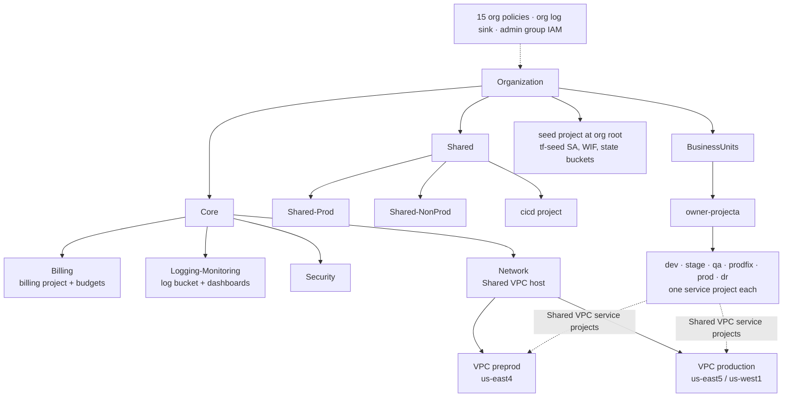

# GCP-SLZ

A Google Cloud Secure Landing Zone written in Terraform. One root module builds the organization's folders, groups,
IAM, org policies, shared VPCs, logging, billing budgets, and per-business-unit projects.

## Description

GCP-SLZ is a reusable template for preparing a Google Cloud organization before any workload lands in it. It follows
Google's landing zone guidance: a `Core` folder for platform projects (billing, logging and monitoring, security,
network), a `Shared` folder, and a `BusinessUnits` folder where each project gets one folder per environment and one
Google Cloud project per environment.

It is aimed at platform and cloud-foundation teams that start from a fresh organization. The code uses the placeholder
`owner` / `client-name` and three sample projects (`projecta`, `projectb`, `projectc`). The intended workflow is to
fork it per client and customize it (see `documentation/docs/index.md`).

Each `.tf` file carries Markdown block comments. A CI job pulls those comments into the MkDocs site under
`documentation/`.

## Features

- **Seed:** a seed project, a `tf-seed` Terraform service account with org- and project-level roles, a GCS state
  bucket, and Workload Identity Federation for GitHub Actions (pool `cicd-terraformer`, provider `gh-actions`,
  restricted to the repo owner).
- **Folders:** `Core` (Billing, Logging-Monitoring, Security, Network), `Shared` (Shared-Prod, Shared-NonProd), and
  `BusinessUnits`. The local `google_folder` module supports up to 10 levels of nesting, plus folder IAM, audit
  configs, and org policies.
- **Groups and IAM:** five Cloud Identity groups (`admins`, `security-admins`, `network-admins`, `audit-admins`,
  `project-admins`) on the org domain, each bound to a curated role set at org or folder level.
- **Organization policies:** 15 org-level constraints (see the caveats in `docs/ARCHITECTURE.md`), including no default network, uniform bucket-level access,
  public access prevention, OS Login required, no VM external IPs, no service account key creation or upload,
  domain-restricted sharing, VPC peering and Shared VPC host restrictions, and no public IP on Cloud SQL.
- **Network:** a Shared VPC host project with `preprod` (us-east4) and `production` (us-east5, us-west1) VPCs. Each
  VPC gets subnets per BU and environment, GKE secondary ranges, Private Service Access, a Serverless VPC Access
  connector, Cloud NAT, and a network firewall policy from the local `network-firewall-policy` module.
- **Logging and monitoring:** an org-wide log sink (audit activity, system events, access transparency, VPC flow,
  firewall) to a GCS bucket that moves logs to Coldline at 180 days and deletes them at 365, plus seven Cloud
  Monitoring dashboards loaded from `terraform/dashboards/*.json`.
- **Billing:** a billing project, Pub/Sub topics, and budgets that alert at 50%, 70%, and 100%.
- **CI/CD project:** a project in `Shared` with Cloud Build and Artifact Registry, attached to the Shared VPC.
- **Business units:** for each sample project, a folder with `dev`, `stage`, `qa`, `prodfix`, `prod`, and `dr`
  subfolders, one service project per environment, and one Terraform state bucket per environment.
  `developers` / `devops` / `admins` groups are created for each project folder under `BusinessUnits`.
- **Quality gates:** pre-commit hooks and GitHub Actions running TFLint, Checkov, Terrascan, tfsec, and
  `terraform fmt`. Docs are built with terraform-docs and MkDocs.

## Architecture



See [docs/ARCHITECTURE.md](docs/ARCHITECTURE.md) for the file map, dependencies, network plan, and the order to
apply it in.

## Requirements

- Terraform `>= 1.5.6` (CI pins 1.5.6). Providers: `google` and `google-beta` `>= 4.81.0`, `random` `>= 3.5.1`.
- A Google Cloud organization and billing account. The identity that runs the first apply needs roughly Organization
  Admin, Folder Admin, Project Creator, Billing User, and Cloud Identity group admin rights.
- Optional: `pre-commit`, `tflint`, `checkov`, `terraform-docs`, and, for the docs, Python with `mkdocs`,
  `mkdocs-material`, `mkdocs-macros-plugin`, `mkdocs-diagrams`, and Graphviz.

## Installation and quick start

```bash
git clone https://github.com/Lapeyus/GCP-SLZ.git
cd GCP-SLZ
pre-commit install            # optional: git hooks

cd terraform
cat > terraform.tfvars <<'EOF'   # ignored by .gitignore
owner           = "<short-org-name>"
org_id          = "<organization-id>"
billing_account = "<billing-account-id>"
EOF
terraform init
terraform plan
```

Before you plan, edit the `domain` in `tf-conf-data.tf` (`data "google_organization" "org"`) so it matches your
organization. The GCS backend in `tf-conf-backend.tf` is commented out: the first apply uses local state and creates
the `<owner>-tf-seed-state` bucket. After that, uncomment the backend and run `terraform init -migrate-state`.

## Usage

- **Add a business-unit project:** copy one of the `projecta` blocks in `bu-folders.tf`, `bu-projects.tf`,
  `bu-tfstate-buckets.tf`, and `bu-groups.tf` (the `members` map). Add its API list to `var.activate_apis` and its
  subnets to `slz-projects-network.tf`.
- **Change org policies:** edit `slz-org-policy.tf`. Each policy is its own `org_policy_v2` module with
  `exclude_folders` / `exclude_projects` lists.
- **Add a dashboard:** put a Cloud Monitoring dashboard JSON file in `terraform/dashboards/`. It is picked up through
  `fileset()`.
- **Build the docs locally:**

  ```bash
  pip install mkdocs mkdocs-material mkdocs-macros-plugin mkdocs-diagrams graphviz pymdown-extensions
  mkdocs serve --config-file documentation/mkdocs.yml
  ```

## Repository layout

```text
.
├── terraform/                     # single root module
│   ├── tf-conf-*.tf               # providers, backend, variables, org data source, outputs
│   ├── seed.tf                    # seed project, tf-seed SA, IAM, Workload Identity Federation
│   ├── slz-folders-core.tf        # Core / Shared / BusinessUnits folder tree
│   ├── slz-groups.tf              # five admin groups
│   ├── slz-groups-iam.tf          # role bindings for those groups
│   ├── slz-org-policy.tf          # 15 organization policies
│   ├── slz-projects-billing.tf    # billing project, budgets, Pub/Sub
│   ├── slz-projects-cicd.tf       # CI/CD project
│   ├── slz-projects-log-monitor.tf# monitoring project, log sink, dashboards
│   ├── slz-projects-network.tf    # Shared VPC host, VPCs, PSA, NAT, connectors, firewall policy
│   ├── bu-*.tf                    # business-unit folders, projects, groups, state buckets
│   ├── dashboards/*.json          # Cloud Monitoring dashboards
│   └── modules/
│       ├── google_folder/         # nested folders + IAM + audit config + org policy
│       └── network-firewall-policy/ # global/regional network firewall policy and rules
├── documentation/
│   ├── mkdocs.yml                 # MkDocs Material site
│   └── docs/                      # one page per .tf file, code/ (generated), img/, scripts/ (diagram + doc generators)
├── .github/workflows/
│   ├── terraform-slz.yml          # tflint, checkov, terrascan, tfsec, terraform fmt
│   └── document-slz.yml           # terraform-docs, doc extraction, MkDocs deploy to Pages
└── .pre-commit-config.yaml
```

## Configuration

| Variable | Default | Purpose |
|----------|---------|---------|
| `owner` | `client-name` | Prefix for folders, projects, buckets, and the WIF repo condition |
| `org_id` | placeholder | Organization ID |
| `billing_account` | placeholder | Billing account linked to every project |
| `activate_apis` | map | APIs per project type (`seed`, `Billing`, `Network`, `CICD`, `projecta`…). The seed project enables all of them |

Other values are hard-coded and should be reviewed: the org `domain` in `tf-conf-data.tf`, regions and CIDRs in
`slz-projects-network.tf`, budget amounts in `slz-projects-billing.tf`, and the firewall rule IP ranges (empty
lists). `.gitignore` excludes `*.tfvars`, state files, `.terraform/`, `key.json`, `*.hcl`, and `documentation/site/`.

## Tests

There are no unit tests. The static checks run in CI and through pre-commit. Checked locally on 2026-10-27 with
Terraform 1.15.8:

- `terraform fmt -check -recursive`: passes.
- `terraform init -backend=false && terraform validate`: **"Success! The configuration is valid."**

## Deployment

- `terraform-slz.yml` runs on every push and PR. The `terraform init/plan/apply` steps and the Workload Identity auth
  step are present but commented out, so CI only lints and checks formatting today. Apply is manual.
- `document-slz.yml` runs after the Terraform workflow on `main`. It regenerates `terraform/README.md` with
  terraform-docs, extracts the block comments into `documentation/docs/code/`, commits them, and deploys MkDocs to
  GitHub Pages.

## Status and known limitations

- **Status:** template, inactive since 2023-09-25 (first commit 2023-08-25).
- `seed.tf` creates a `google_service_account_key` for bootstrapping, while `slz-org-policy.tf` turns on
  `disable_service_account_key_creation`. Remove the key after the first apply, or apply the policy last.
- Some placeholders still need editing: the org domain, the firewall rule IP ranges (empty), the API name
  `seprojectbitycenter.googleapis.com` in the seed list (a typo of `securitycenter`), and the commented-out
  `google_monitoring_monitored_project`.
- `bu-groups.tf` lists the `BusinessUnits` children with a `google_folders` data source, so the BU groups only show
  up on the apply after the folders exist (two applies on a fresh org).
- Four list-type org constraints (domain-restricted sharing, VM external IP, VPC peering, Shared VPC hosts) are
  declared with `policy_type = "boolean"` and no values. `terraform validate` accepts them, but they need fixing before
  apply. `requireOsLogin` has no rules.
- The `projectb` resources skip the `owner_` prefix that `projecta` and `projectc` use.
- `documentation/mkdocs.yml` still points `repo_url` and the logo at the repository this template came from.

## License

Apache License 2.0. See [LICENSE](LICENSE).
