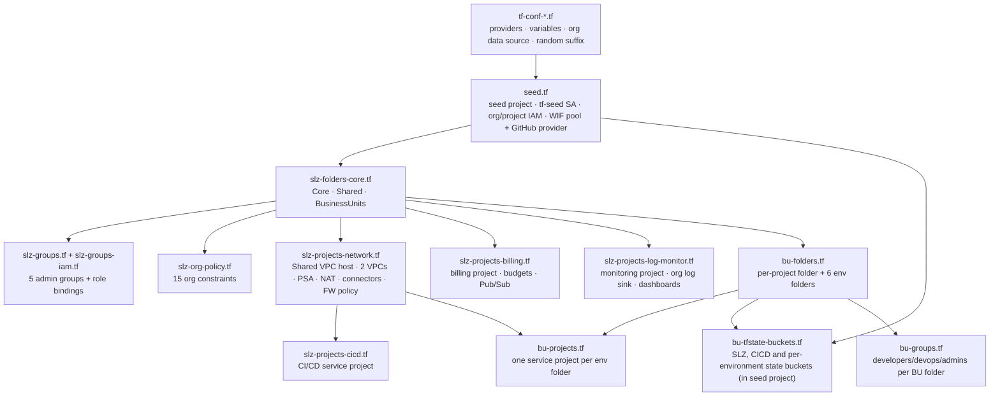
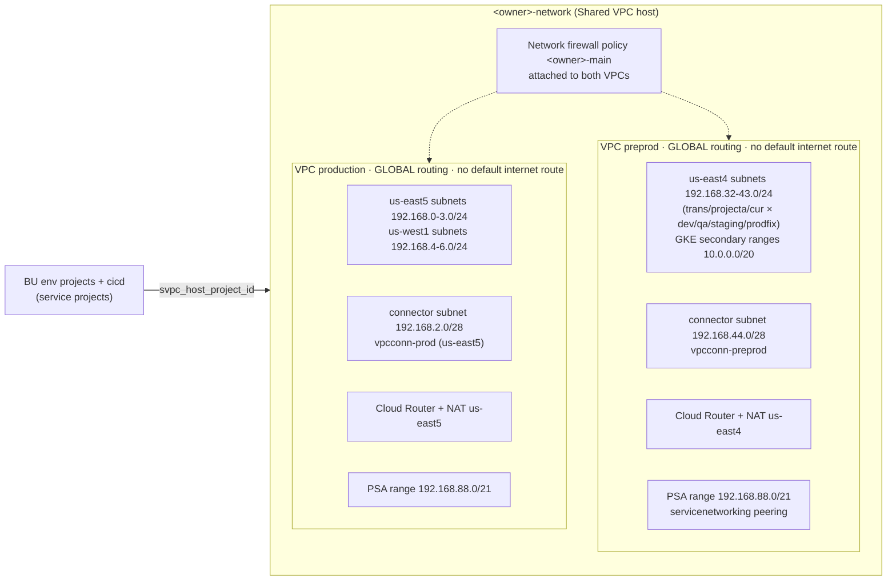
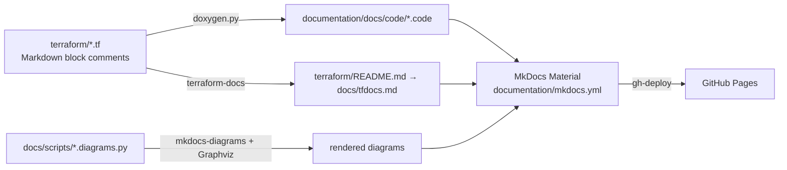

# GCP-SLZ architecture

This document describes how the Terraform in `terraform/` is put together. All of it is one root module with a
single state. The `slz-*` files build the organization-wide foundation, and the `bu-*` files add business units on
top of it.

## 1. Layers and apply order

Terraform works out the order from references. The logical layers are:



Bootstrap sequence on a new organization:

1. Run as a human org admin with local state. `terraform apply` creates the seed project, the `tf-seed` SA, the
   state buckets, and everything else.
2. Uncomment the `gcs` backend in `tf-conf-backend.tf` (bucket `<owner>-tf-seed-state`) and run
   `terraform init -migrate-state`.
3. Run a second apply. `bu-groups.tf` reads the `BusinessUnits` children through a data source, so the BU groups
   only appear once those folders exist.
4. Optional: turn on the commented `google-github-actions/auth` and `plan`/`apply` steps in
   `.github/workflows/terraform-slz.yml` so CI deploys through Workload Identity Federation instead of keys.

## 2. Resource hierarchy

```text
organizations/<org_id>
├── <owner>-seed                       (project, at org root)
├── Core/
│   ├── Billing/            → <owner>-cor-billing
│   ├── Logging-Monitoring/ → <owner>-logging-monitoring
│   ├── Security/
│   └── Network/            → <owner>-network   (Shared VPC host)
├── Shared/                 → <owner>-cicd      (Shared VPC service project)
│   ├── Shared-Prod/
│   └── Shared-NonProd/
└── BusinessUnits/
    ├── <owner>-projecta/
    │   ├── dev/ stage/ qa/ prodfix/ prod/ dr/   → one project each (Shared VPC service project)
    ├── <owner>-projectb/  (same)
    └── <owner>-projectc/  (same)
```

Projects are created with `terraform-google-modules/project-factory` 14.3.0, with random ID suffixes and the default
service account disabled or deleted. APIs come from `var.activate_apis[<type>]`. The seed project turns on the
**union** of every list so the `tf-seed` SA can manage them in child projects.

The local module `modules/google_folder` takes a map of folders that point to their parent either by
`external_parent_id` or by `parent_entry_key`. It resolves them in up to 10 layers of `google_folder` resources. The
same map can also carry folder IAM (`iam`, `iam_mode`), audit log configs, and legacy folder org policies.

## 3. Identity and access

| Principal | Scope | Roles (summary) |
|-----------|-------|-----------------|
| `tf-seed` SA | organization | organizationAdmin, projectCreator, folderAdmin, compute.xpnAdmin, serviceUsageAdmin, billing.user, iam.serviceAccountAdmin |
| `tf-seed` SA | seed project | service usage, SA key/admin/token creator, workload identity user and pool admin, storage admin/object roles |
| GitHub Actions (WIF) | `tf-seed` SA | `roles/iam.workloadIdentityUser` for `attribute.repository/<owner>/<repo>`. The provider's `attribute_condition` allows only `repository_owner == owner` |
| `admins@` | organization | organizationAdmin, iam.securityAdmin, orgpolicy.policyAdmin, billing.admin |
| `security-admins@` | organization | iam.securityAdmin, orgpolicy.policyAdmin, iam.serviceAccountAdmin, folderAdmin, logging.configWriter, compute.securityAdmin |
| `network-admins@` | organization | compute.networkAdmin, vpcaccess.admin, dns.admin, compute.loadBalancerAdmin, compute.securityAdmin |
| `audit-admins@` | organization | iam.securityReviewer, logging.viewer, audit.configViewer, errorreporting.viewer, serviceUsageConsumer |
| `project-admins@` | `BusinessUnits` and `Shared` folders | editor, SA admin and token creator, Artifact Registry admin, projectIamAdmin, storage.admin, compute.admin |
| `<bu>-developers/devops/admins@` | (groups only) | Created with empty `members` maps. No role bindings are defined yet |

The security, network, and audit groups have a commented `folders = [...]` line, so they can be narrowed from org
level to their `Core` subfolder.

## 4. Organization policies

All 15 are set at the organization with `org_policy_v2` 5.2.2, and every module declares `policy_type = "boolean"`:

`compute.skipDefaultNetworkCreation`, `storage.uniformBucketLevelAccess`, `storage.publicAccessPrevention`,
`compute.disableGlobalSerialPortAccess`, `compute.restrictXpnProjectLienRemoval`, `sql.restrictPublicIp`,
`compute.disableNestedVirtualization`, `compute.disableGuestAttributesAccess`, `compute.requireOsLogin`,
`iam.allowedPolicyMemberDomains`, `compute.vmExternalIpAccess`, `compute.restrictVpcPeering`,
`compute.restrictSharedVpcHostProjects`, `iam.disableServiceAccountKeyCreation`,
`iam.disableServiceAccountKeyUpload`.

Caveats in the current code:

- `compute.requireOsLogin` has `rules = []`, so it sets no enforcement rule. The other 14 have
  `enforcement = true`.
- `iam.allowedPolicyMemberDomains`, `compute.vmExternalIpAccess`, `compute.restrictVpcPeering`, and
  `compute.restrictSharedVpcHostProjects` are **list** constraints in Google Cloud but are declared here as boolean
  with no allowed values. Expect them to fail at apply, or to need `policy_type = "list"` with the allowed customer
  IDs, VMs, networks, or host projects for your organization.

Each module exposes `exclude_folders` / `exclude_projects` for exceptions.

## 5. Network



- Both VPCs drop the default internet gateway routes. Egress goes through Cloud NAT.
- Private Service Access (Cloud SQL, Memorystore, and similar) uses a /21 per VPC, with custom routes imported and
  exported on the peering.
- The firewall policy module (`modules/network-firewall-policy`) builds global or regional network firewall policies,
  VPC associations, and rules. The two sample rules (ingress from owner IPs, egress for Cloud Run jobs) have **empty**
  IP lists and need values.

## 6. Logging, monitoring, billing

- **Org log sink** `<owner>-log-sink` (with children) sends audit activity, system events, access transparency, VPC
  flow logs, and firewall logs to `gs://<owner>-org-logs-<suffix>` in the monitoring project. Logs move to Coldline
  after 180 days and are deleted after 365.
- **Dashboards:** every `terraform/dashboards/*.json` file (BigQuery, Cloud Storage, GCE, GKE, Cloud SQL Postgres,
  registry, VPC flow logs) becomes a `google_monitoring_dashboard` in the monitoring project. The metrics-scope
  attachment (`google_monitoring_monitored_project`) is commented out.
- **Budgets:** the billing project gets a 1000 budget in the billing account's currency. Two budget modules publish
  alerts at 50%, 70%, and 100% to the `prod` / `preprod` Pub/Sub topics. As written, both budgets cover only the
  billing project itself.

## 7. Terraform state

All state buckets live in the seed project in `us-east1`, with public access prevention enforced and
`roles/storage.objectViewer` granted to `gcp-organization-admins@<owner>.com`:

- `<owner>-tf-seed-state`: state for this SLZ.
- `<owner>-tf-cicd-state`: state for CI/CD project workloads.
- One bucket per BU environment folder key (for example `<owner>-projecta-dev`), for the BU teams' own Terraform.

## 8. Documentation pipeline



The pages in `documentation/docs/*.md` pull in the generated `code/*.code` snippets through `mkdocs-macros`.

## 9. Known gaps

- A `google_service_account_key` is created in `seed.tf` while `iam.disableServiceAccountKeyCreation` is enforced.
  Delete the key after bootstrap and rely on WIF.
- The `gcp-organization-admins@` group named in the state-bucket IAM is not created by this code. The groups module
  creates `admins@<domain>`.
- The CI apply is turned off (commented out). Only lint, security scans, and `terraform fmt -check` run.
- Four list constraints are declared as boolean (see section 4).
- The seed API list has a typo (`seprojectbitycenter.googleapis.com`).
